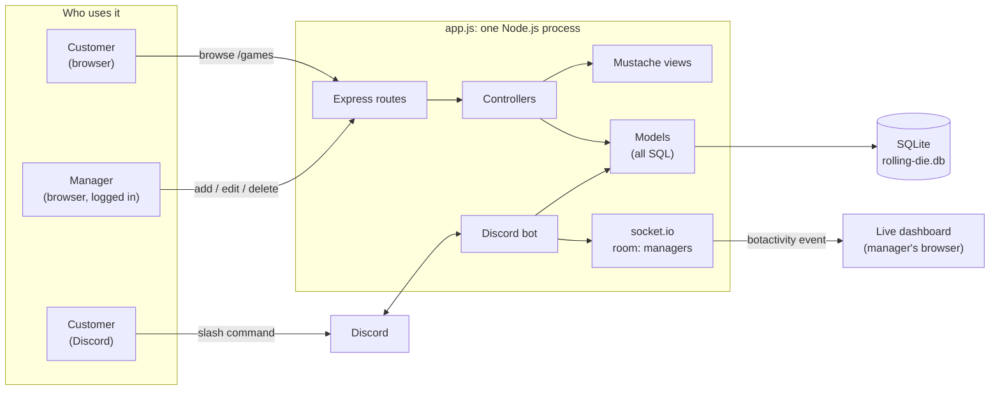
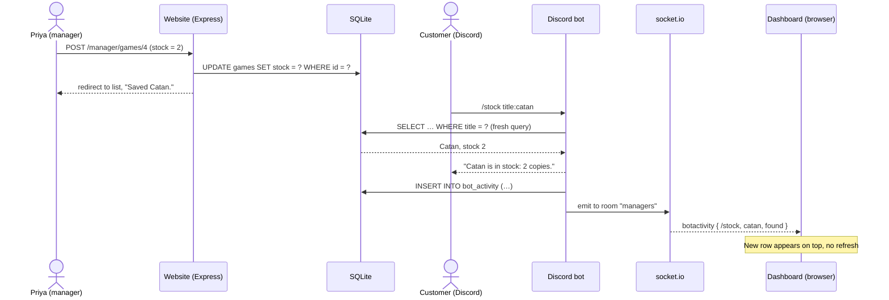
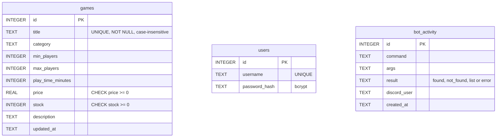

# The Rolling Die — Inventory Web App + Discord Bot

An inventory system for **The Rolling Die**, a board game store and café.
Customers can browse what's on the shelf on a public web page or by asking a
Discord bot; staff manage the inventory behind a login and watch what
customers are asking the bot for on a live dashboard.

Every piece reads the same SQLite database at the moment it is used, so a
stock change made on the website shows up in the very next Discord reply.

College project (Mohawk College, Project #1) by Juan Pablo Naranjo.

## Contents

- [Features](#features)
- [How it fits together](#how-it-fits-together)
- [Requirements](#requirements)
- [Setup](#setup)
- [Using it](#using-it)
- [Security](#security)
- [Project structure](#project-structure)
- [Troubleshooting](#troubleshooting)
- [Submitting the project](#submitting-the-project)

## Features

**Public inventory page** (`/` and `/games`, no login)

- Every game with category, player count, play time, price and stock
- Search by title and filter by category; clear "in stock" / "out of stock"
- Read-only: no edit controls at all

**Manager area** (`/manager`, login required)

- Add, edit and delete games, with server-side validation (title required,
  price ≥ 0, stock a whole number ≥ 0, minimum players ≤ maximum players)
- Accounts are created from the terminal; there is no public sign-up

**Discord bot** (slash commands, each answered from live data)

| Command | What it answers |
| --- | --- |
| `/stock title:` | Is it in stock, and how many copies? |
| `/price title:` | How much does it cost? |
| `/game title:` | Full details: players, play time, category, price, stock |
| `/find players: max_price:` | In-stock games for that many players, optionally under a price |

Titles match exactly first (ignoring case), then by partial title; several
matches are listed. While typing a title, Discord suggests games from the
database (autocomplete).

**Live dashboard** (`/manager/dashboard`, login required)

- Every bot command appears within a second, no refresh needed
- Searches for games the store doesn't carry are highlighted in red:
  they show what customers want that isn't on the shelf

## How it fits together

### Architecture

One Node.js process (`app.js`) runs the website, the socket.io server and the
Discord bot together, so they share one database connection and one `io`
object. The website follows MVC: routes call **controllers**, controllers
call **models** (the only place SQL lives), and **views** are Mustache
templates.



### How a website edit reaches Discord and the dashboard

Nothing is cached: the bot runs a fresh query for every command, then the
reply is saved to `bot_activity` and pushed only to logged-in managers.



### Database



The tables are independent: `bot_activity` stores what was searched for
(text), not a link to a game, so it also records games the store doesn't have.

> The diagrams are [Mermaid](https://mermaid.js.org/). They render on GitHub
> and in VS Code's Markdown preview with the "Markdown Preview Mermaid
> Support" extension.

## Requirements

- [Node.js](https://nodejs.org/) 18 or newer (tested on 24) and npm
- A Discord account and a Discord server where you can add bots
  (a personal test server is fine)

## Setup

### 1. Install dependencies

```bash
npm install
```

### 2. Create the Discord application and bot

1. Go to the [Discord Developer Portal](https://discord.com/developers/applications)
   and click **New Application**.
2. **General Information** → copy the **Application ID** (this is `CLIENT_ID`).
3. **Bot** → **Reset Token** → copy the token (this is `BOT_TOKEN`).
   Treat it like a password: anyone with it controls the bot.
4. **OAuth2 → URL Generator** → tick the scopes **`bot`** and
   **`applications.commands`**, open the generated URL and add the bot to
   your server.
5. In Discord, turn on **Settings → Advanced → Developer Mode**, then
   right-click your **server icon** → **Copy Server ID** (this is
   `GUILD_ID`). Right-clicking a channel or a user copies the wrong ID.

The bot only needs the **Guilds** intent; no privileged intents are required.

### 3. Configure environment variables

```bash
cp .env.example .env
```

Fill in `.env`:

| Variable | What it is |
| --- | --- |
| `BOT_TOKEN` | Bot token from step 2.3 |
| `CLIENT_ID` | Application ID from step 2.2 |
| `GUILD_ID` | Server ID from step 2.5 |
| `SESSION_SECRET` | Long random string that signs login cookies (see below) |
| `PORT` | Web server port (default `3000`) |

Generate a session secret:

```bash
node -e "console.log(require('crypto').randomBytes(32).toString('hex'))"
```

`.env` is in `.gitignore` and must never be committed. The app refuses to
start if `SESSION_SECRET` is missing or still `change-me`.

### 4. Create the database

```bash
npm run init-db
```

Creates `rolling-die.db` with the three tables and 15 games (including
Wingspan, Catan, and two games that are out of stock). Safe to run again:
it only adds missing seed games and never overwrites your edits.

### 5. Create a manager account

```bash
npm run create-user -- priya
```

You will be asked for the password twice at a hidden prompt (at least 8
characters). Use any username you like.

### 6. Register the slash commands

```bash
npm run deploy-commands
```

Expected output: `Registered 4 commands: /stock, /price, /game, /find`.
Run it again only if a command's name or options change.

### 7. Start everything

```bash
npm start
```

Expected output:

```text
The Rolling Die running at http://localhost:3000
Discord bot logged in as <your bot name>
```

Without a `BOT_TOKEN` the website still runs and the bot is skipped.

## Using it

1. Open <http://localhost:3000>: the public inventory. Try a search and a
   category.
2. Click **Manager login**, sign in, and open **Dashboard** in a second tab.
3. In Discord, run `/stock title:wingspan`: the reply appears in Discord and
   a new row appears on the dashboard instantly.
4. On the website, edit Wingspan's stock and save. Run `/stock title:wingspan`
   again: the new number is in the reply.
5. Run `/stock title:root`: a polite "we don't carry it" reply, and a red
   **Not in store** row on the dashboard.

### npm scripts

| Script | What it does |
| --- | --- |
| `npm start` | Runs the website, socket.io and the bot (`app.js`) |
| `npm run init-db` | Creates the tables and seeds the games |
| `npm run create-user -- <name>` | Creates a manager account |
| `npm run deploy-commands` | Registers the slash commands in your server |

## Security

- **Secrets** live only in `.env`, which is git-ignored; nothing is hardcoded.
- **SQL injection:** every query uses `?` placeholders; user input is never
  joined into SQL. Searches also escape the `%` and `_` LIKE wildcards.
- **XSS:** Mustache `{{ }}` escapes all data. The dashboard adds live rows
  with `textContent`, never `innerHTML`, and the delete confirmation reads
  the title from a `data-` attribute instead of inline JavaScript.
- **Passwords** are hashed with bcrypt (cost 12). Wrong username and wrong
  password give the same message and take the same time.
- **Sessions:** the cookie is `httpOnly` and `sameSite: 'lax'`, the session
  ID is regenerated on login, and logout destroys it.
- **Manager area:** every `/manager` route is behind `requireLogin`, and
  every change (add, edit, delete, logout) is a POST, never a GET.
- **Live dashboard:** socket.io shares the website's session; sockets
  without a logged-in user are disconnected, and events go only to the
  `managers` room. Logging out also closes that session's open sockets.
- **Discord:** every reply uses `allowedMentions: { parse: [] }`, so
  searching for `@everyone` can't ping anyone, and user text is
  markdown-escaped.

### Known limitations

- No limit on login attempts (no rate limiting).
- Sessions are kept in memory, so restarting the server logs everyone out.
- Without JavaScript, delete happens without the confirmation dialog
  (it is still a POST that requires login).

## Project structure

```text
app.js                      wiring: Express, sessions, socket.io, bot, routes
config/db.js                SQLite connection + promise helpers (run/get/all)
config/session.js           session middleware shared by Express and socket.io
models/gameModel.js         all SQL for games
models/userModel.js         manager accounts
models/activityModel.js     bot activity log
controllers/publicController.js    public inventory page
controllers/authController.js      login / logout
controllers/managerController.js   CRUD + dashboard page
middleware/requireLogin.js  blocks /manager for logged-out visitors
helpers/gameView.js         formats a game for views and bot replies
helpers/activityView.js     formats an activity row (page and live event)
bot/bot.js                  Discord client, reply + activity logging
bot/commands.js             slash command definitions and handlers
views/*.mustache            pages; views/partials/ header and footer
public/css/style.css        styles
public/js/dashboard.js      live dashboard (socket.io client)
public/js/confirm-delete.js delete confirmation
scripts/init-db.js          create tables + seed games
scripts/create-user.js      create a manager account
scripts/deploy-commands.js  register slash commands
.env.example                template for .env
ai_log.txt                  AI usage log (written by the developer)
```

## Troubleshooting

| Problem | Fix |
| --- | --- |
| `deploy-commands failed: 401: Unauthorized` | `BOT_TOKEN` is wrong or still the placeholder. Reset it in the portal and paste the new one. |
| `deploy-commands failed: Missing Access` | The bot isn't in the server named by `GUILD_ID`, or `GUILD_ID` is a channel/user ID. Redo setup steps 2.4 and 2.5. |
| Commands don't appear or show old options in Discord | Run `npm run deploy-commands`, then press Ctrl+R in Discord. |
| `Set a long random SESSION_SECRET in .env` on start | Generate a secret (setup step 3). |
| Edits to `.mustache` files don't show | Restart `npm start` (templates are cached). |
| Dashboard says "Disconnected. Log in again" | The session ended (logout or server restart). Log in again. |
| Forgot a manager password | Create another account with `npm run create-user -- <name>`. |

## Submitting the project

The zip must include the `.git` folder (commit history) and `ai_log.txt`,
and must **not** include `.env` (it contains the real bot token) or
`node_modules`.

From the folder that contains `rolling-die/`:

```bash
zip -r rolling-die.zip rolling-die \
  -x 'rolling-die/node_modules/*' \
  -x 'rolling-die/.env' \
  -x 'rolling-die/rolling-die.db' \
  -x 'rolling-die/.taste-skill/*'
```

Then check the result:

```bash
unzip -l rolling-die.zip | grep -E '\.git/HEAD|ai_log\.txt'     # both listed
unzip -l rolling-die.zip | grep -E '\.env$|node_modules'        # nothing listed
```

The database is left out on purpose: whoever runs the project recreates it
with `npm run init-db`.
